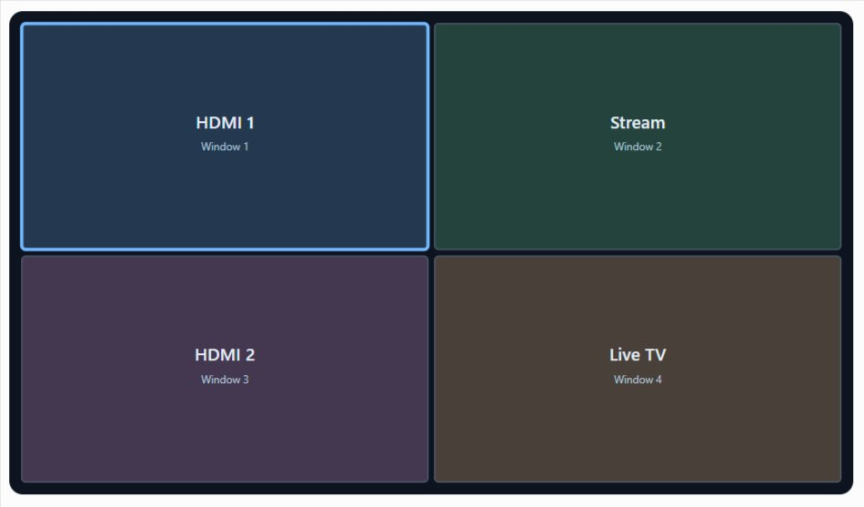

# webOS MultiView

> **Experimental prototype for research and controlled testing only.**
> [Device safety and disclaimer](#device-safety-and-disclaimer)

webOS MultiView is an experimental homebrew project for LG TVs. The goal is
a standalone foreground app where you choose two or more of the TV's inputs
and watch them advance independently in a split-screen, grid or inset layout.
Research starts with physical HDMI and the built-in tuner.

## What works today

On the **LG OLED55C14LB running firmware 03.53.45**, native probe 0.1.12
showed moving HDMI 4 with sound in an app window for eight seconds.
Normal picture, sound and remote control returned on exit.
[Device test](docs/device-tests/c1-journal.md#0112-physical-hdmi-4--moving-picture-and-sound)

## Which sources play together?

The matrix records C1 device trials by input type. A pass means both pictures
advanced together. A fail means the tested setup did not achieve overlap.

✅ **Pass** · ❌ **Fail** · **—** Untested

| Source type | HDMI | Live TV (tuner) | Local clip | Network video | webOS app |
|:---|:---:|:---:|:---:|:---:|:---:|
| **HDMI** | ❌ Fail | ❌ Fail | — | — | — |
| **Live TV (tuner)** | ❌ Fail | — | — | — | — |
| **Local clip** | — | — | ✅ Pass | — | — |
| **Network video** | — | — | — | — | — |
| **webOS app** | — | — | — | — | — |

- **HDMI + HDMI** took turns in the browser probe. HDMI 4 resumed after HDMI 1 closed. [HDMI pair trial](docs/device-tests/c1-journal.md#browser-hdmi-pair--40-second-retry)
- **HDMI + live TV** took turns in the browser probe. HDMI 4 resumed after the tuner preview closed. [Tuner playback trial](docs/device-tests/c1-journal.md#hdmi-4-and-live-tuner-playback)
- **Local clip + local clip** briefly played in separate windows with both pictures moving. Audio ownership and sustained playback remain open. [Local clip trial](docs/device-tests/c1-journal.md#phase-1)

Network video includes IPTV. Three or more sources require their own trial.
[Source combinations](docs/research/c1-hdmi-evidence-ledger.md#source-combinations)

## Where Phase 2 stands

The hardware milestone is **independently live HDMI 1 + HDMI 2**. C1 pair
trials are parked pending evidence of a second app-owned playback path.
For two live TV channels, the offline allocator kept the first channel's
allocation and granted no second decoder.
[Trial reopening conditions](STATUS.md#c1-trial-readiness) · [Roadmap](ROADMAP.md#phase-2-route-to-two-pictures)

## Concept layouts

These mockups illustrate planned layouts. The source combinations shown are
still unverified on the TV.

| Four-source grid | Three-source split | Picture-in-picture |
| --- | --- | --- |
|  |  |  |

## Run the host checks

Run these commands from the repository root in PowerShell. The quick start
was verified with Node.js 24 and npm 11. The monitor tests use Git for Windows
Bash and AWK.

```powershell
npm ci
npm test
npm run lint
```

The tests run offline after dependency installation. Native builds use the
webOS SDK and retained device libraries. Tested IPKs live under local
`dist/`. [Build and package details](docs/build.md)

## Follow or contribute to the research

- Find the active source, tests and artifact rules in the [documentation index](docs/README.md).
- See what was tried, what worked and why each investigation stopped in the [research history](docs/research/c1-hdmi-evidence-ledger.md#research-history).
- Review the [contributor rules](AGENTS.md) and [device safety](docs/safety.md) before a TV experiment.

## Device safety and disclaimer

**Use the [host checks](#run-the-host-checks) if you just want to try the project.**
Root-assisted experiments can interrupt normal viewing or leave a TV unusable.
Keep experimental builds off any TV you rely on. Before a device trial, confirm
the exact model and firmware, get the owner's explicit permission, and make sure
you have a way to restore normal operation. Stop if the TV behaves unexpectedly.
Follow the [device safety rules](docs/safety.md) and [current test procedure](docs/device-tests/current-plan.md).

webOS MultiView is an independent homebrew project unaffiliated with LG
Electronics. webOS is a trademark of LG Electronics. See the
[publication rules](docs/safety.md#public-repository) for research material
and third-party files. The software is provided as is, without express or implied
warranties. Use it at your own risk. To the extent permitted by applicable law,
the maintainers disclaim liability for device damage, data loss, or other
losses arising from use of the project.
