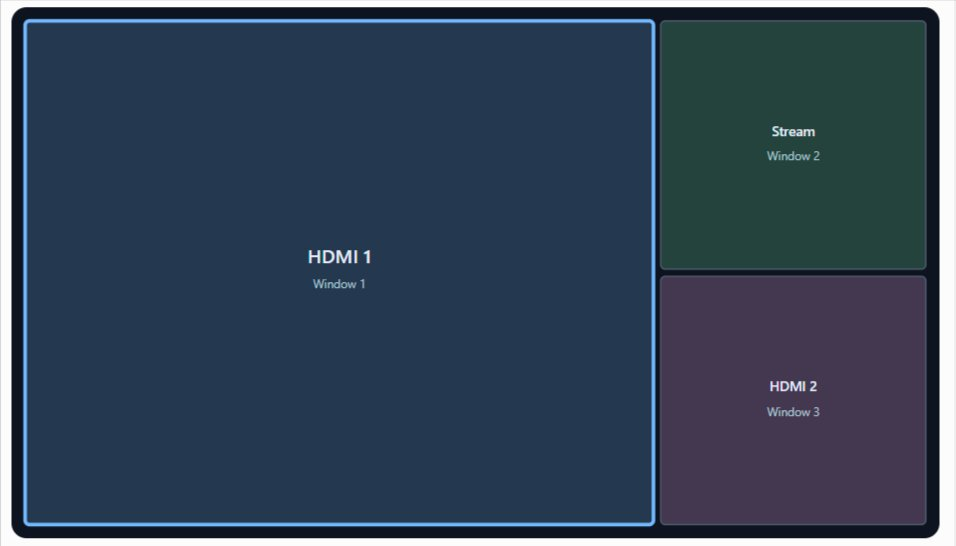
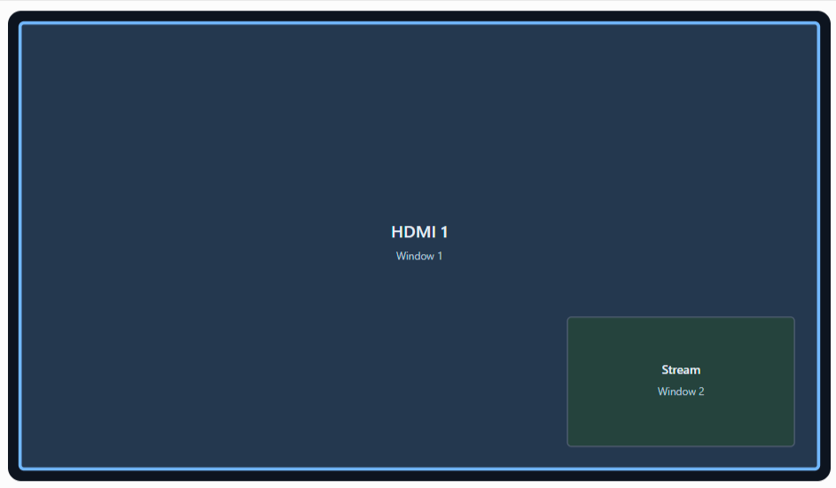

# webOS MultiView

> **Experimental prototype for research and controlled testing only.**
> [Device safety and disclaimer](#device-safety-and-disclaimer)

webOS MultiView is a root-assisted homebrew research project for LG TVs. The
long-term goal is to show **several independently live sources at once** in
movable windows, including layouts with more than two sources. A layout could
combine HDMI inputs, live TV, another webOS app and a network stream in
picture-in-picture, split-screen or a grid. The available combinations will
depend on the TV model and firmware.

## What works today

- **Verified on an LG OLED C1 running firmware 03.53.45.** Prototype 0.1.12
  displayed continuously moving video from physical HDMI 4 in a fixed, centered
  app window with audible sound during one eight-second trial. The app exited
  and normal picture, sound and remote control returned. [Device test and evidence](docs/device-tests/c1-journal.md#0112-physical-hdmi-4--moving-picture-and-sound)
- **Verified in the standalone JS probe.** HDMI 4 played with sound. With HDMI 4 and laptop HDMI 1 both connected, the second picture took over and the first resumed after it closed. [Browser pair trial](docs/device-tests/c1-journal.md#browser-hdmi-pair--40-second-retry)
- **Unknown.** Simultaneous HDMI 1 and HDMI 2, sustained stability, independent
  audio control, hardware resource release and compatibility with other
  models or firmware remain unverified. [Current status](STATUS.md)

Follow the [roadmap](ROADMAP.md#phase-2-route-to-two-pictures) for the route from one working HDMI picture to two independently live sources. [Status](STATUS.md) identifies the next experiment and its readiness.

The tested `0.1.12` IPK is a local research artifact under ignored `dist/`.
A fresh checkout contains the source and host checks. Native builds use an
existing webOS SDK and retained device libraries. [Build and package details](docs/build.md)

## Concept layouts

These mockups illustrate planned layouts. The source combinations shown are
still unverified on the TV.

| Four-source grid | Three-source split | Picture-in-picture |
| --- | --- | --- |
|  |  |  |

## Run the host checks

Run these commands from the repository root in PowerShell. The quick start
was verified with Node.js 24 and npm 11.

```powershell
npm ci
npm test
npm run lint
```

These checks run offline after dependency installation. The tests exercise the
native prototype's launch rules, both browser HDMI probes, cleanup and evidence
reporting with simulated transports. Synthetic TV resource manager (TVRM)
exchanges exercise the offline receiver decoder. Lint checks JavaScript and JSON syntax,
Markdown links, source references and policy consistency. The device runner
requires retained private files. [Native checks and build guide](docs/build.md)

## Follow or contribute to the research

For the progression from the native HDMI prototype to the Glasshouse-style JS probe, connector ownership and receiver allocation, read the [research history](docs/research/c1-hdmi-evidence-ledger.md#research-history). Each stage records what ran on the C1, why the route changed, and the evidence behind that decision.

- Read the [current status](STATUS.md) for the next task and the [roadmap](ROADMAP.md)
  for the planned milestones.
- Find the app entry point and report format in the [prototype contract](native/phase2-hdmi-candidate-0.1.12/README.md).
  The [repository layout](docs/repository-layout.md) maps the shared native code
  and host runner.
- Trace the HDMI path in the [C1 research map](docs/research/c1-hdmi-interface-map.md)
  and find prior results in the [documentation index](docs/README.md).
- Review the [contributor rules](AGENTS.md) and [device safety](docs/safety.md)
  before proposing changes or experiments.

## Device safety and disclaimer

**Use the [host checks](#run-the-host-checks) if you just want to try the project.**
Root-assisted experiments can interrupt normal viewing or leave a TV unusable.
Keep experimental builds off any TV you rely on. Before a device trial, confirm
the exact model and firmware, get the owner's explicit permission, and make sure
you have a way to restore normal operation. Stop if the TV behaves unexpectedly.
Follow the [device safety rules](docs/safety.md) and [current test procedure](docs/device-tests/current-plan.md).

webOS MultiView is an independent homebrew project unaffiliated with LG
Electronics. webOS is a trademark of LG Electronics. See the
[publication rules](docs/safety.md#public-repository) for research material
and third-party files. The software is provided as is, without express or implied
warranties. Use it at your own risk. To the extent permitted by applicable law,
the maintainers disclaim liability for device damage, data loss, or other
losses arising from use of the project.
