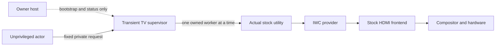

# Independent IWC recovery supervisor — design review

> Research/tool record. [Current status](../../STATUS.md) · [Documentation index](../README.md). Earlier next steps and untested labels describe that stage; use Status and later device records for current results.

2026-11-12; reference LG OLED C1, firmware 03.53.45 / SDK 6.5.3.
**Design only. No supervisor implemented/built/packaged or TV-tested. No TV
connection, app launch, permission edit, utility execution or geometry/crop
request in this review.**

Plan: use the saved root-read results, caller roles, local model and C1 relay/
frontend/compositor traces; define a supervisor's lifetime and authority; split
ordering guarantees by layer; audit every failure without claiming that local
simulation proves physical recovery.

## Decision

Select a **candidate transient TV-side supervisor**, separate from the actor
and SSH session, as the sole issuer of our experiment's commands. Keep the actor
unprivileged with no direct privileged writer interface. The supervisor would
use fixed child invocations of the actual stock utility under that utility's
existing role. It would not impersonate the utility, expose a generic command
endpoint, install a persistent service or change LS2 grants.

This route is justified for **further local, non-mutating lifecycle work only**.
Root diagnostic listing admission is verified; supervisor independence and
setter/application ordering are not. Active geometry/crop remains
**unsafe_to_test**. The design cannot promise recovery from its own death,
lost downstream delivery, provider/frontend failure or power loss.

## Evidence used

- [Root read 002](../device-tests/c1-journal.md#root-read-002): one HDMI-app
  publication, eight pins matched, utility exit/cleanup confirmed; owner later
  confirmed normal HDMI 4 view/motion/sound. Report SHA-256
  `3e46d5953b2aa0928581e3f1ebb6261c5d6ffd93c43dbe930309389d44e2e695`.
- [Permitted caller](c1-iwc-permitted-caller.md): actual stock utility has an
  executable-bound role and its default generated name has `all`; this is not
  an inherited role for a new root executable. Saved ELF SHA-256
  `b9b25626a9d7295cfcaca45052555952dd9113707a45893b4b35c27497d9c2af`.
- [Local model](c1-iwc-local-recovery-model.md): strict gate decisions and one
  pending simulation intent; actor cutoff, timeouts, immutable tuple, no blind
  reset on unresolved action, and separate observation requirements.
- [Ownership/recovery trace](c1-iwc-ownership-recovery.md): IWC manager update
  and publisher relay (`0x6dea–0x6e18`, `0x67ac–0x68b6`), shared broadcast
  (`0x8894–0x8896`), setter response (`0xafaa–0xafca`), frontend callback
  (`route-5.qml:1150–1204`) and compositor reset path (`0x6533c`,
  `0x653e8–0x653fa`). These are static findings, not end-to-end runtime traces.

No new firmware retrieval or vendor source copying was needed. Generic OS
references below clarify requirements; they do not identify the C1's process
manager, cgroup version or observed teardown policy.

## Process and authority boundary

The supervisor's immutable state would hold one fresh target tuple, logical
full-view rectangle, explicit priority 0 and absolute monotonic deadlines.
The actor may request the one reviewed action or cancel; it may not supply a
URI, executable, caller identity, alternate target, crop, priority or arbitrary
rectangle. There is no production IPC design in the current model. Any later
private channel needs ownership/peer checks, bounded framing, one experiment
generation, no unsolicited callers and an irreversible cutoff during recovery.
Model reply tokens correlate events; they are not IPC authentication.

The supervisor itself need not register a new privileged LS2 identity if it
delegates exclusively to the actual stock utility. Each worker must execute
the pinned absolute binary with validated fixed argv and its default name,
without a shell, `-m`, `-a`, generic parameters or borrowed identity. Dynamic
target fields must come only from the supervisor's validated private tuple.
No active-call argv/payload builder is implemented or approved here.

Our **local sole issuer** is not a global IWC lock. Stock applications and
other permitted controllers remain outside that guarantee. Different utility
workers also have different generated names/connections: the supervisor cannot
assume a shared LS2 connection's ordering just because the executable is the same.

## Lifetime requirements and readiness

Before accepting any actor action, a future supervisor would have to establish:

1. A separate TV process/session outside the actor's app/jailer teardown scope.
   It must not depend on an actor thread, Node timer on the PC, SSH channel or
   open terminal for its deadline processing.
2. No inherited SSH stdin/stdout/stderr dependency. Owner-channel EOF is a
   cancellation input, not permission to abandon recovery or die on a status
   write. Disconnect/status-output failure cannot extend the active interval.
3. Monotonic deadlines measured and enforced on the TV, including worker I/O,
   termination and reap. No blocking vendor call may stall the supervisor's
   own state machine. Workers are bounded child processes, with bounded pipes.
4. Startup acknowledgment only after independent execution, private control/
   status channels, cancellation handling and deadlines are ready. If that
   acknowledgment is missing or lost, the actor must never send an action.
   Reconnection cannot rearm, replace the tuple or extend the deadline.
5. Clean status output surviving owner disconnect, containing only redacted
   phase/outcome/exit evidence in private temporary storage. Target IDs remain
   in memory. A diagnostic log is not a restartable recovery journal.

`setsid()` creates a session/process group; it does not establish exemption
from every external supervisor's cleanup. Forked children can also inherit a
parent's resource-control membership. Accordingly, `nohup`, background `&`,
double-fork or `setsid` alone is not accepted as proof of C1 independence.
See [Linux setsid](https://man7.org/linux/man-pages/man2/setsid.2.html) and
[kernel cgroup documentation](https://docs.kernel.org/admin-guide/cgroup-v2.html).
The cgroup-v2 reference is general evidence of an independent lifecycle axis,
not a claim that this TV uses v2. No cgroup/namespace/job modification is proposed.

Parent-death signal configuration must be reviewed rather than blindly enabled
on the supervisor: killing it with its launcher defeats host independence.
Linux documents inherited/cleared state and credential caveats for
[`PR_SET_PDEATHSIG`](https://man7.org/linux/man-pages/man2/PR_SET_PDEATHSIG.2const.html).
These conditions have not been measured on the C1.

The supervisor must track/reap only children it owns. A termination request,
pipe EOF, PID disappearance or host SSH close is not interchangeable with a
successful child exit. Use explicit owned-child exit status and bounded waits;
[waitpid documentation](https://man7.org/linux/man-pages/man2/waitpid.2.html)
explains child state/termination reporting. Do not use broad process-name kills,
signal stock HDMI/IWC processes or treat killing a worker as request retraction.

## Ordering ledger

| Layer | Available guarantee | Missing evidence / rule |
|---|---|---|
| Actor requests → supervisor queue | **Verified in local model:** action channel closes permanently; at most one action and one reset; no late actor write. | A real IPC/process implementation is still absent. No global exclusivity is implied. |
| Supervisor → owned utility child | **Candidate:** only one worker outstanding; next stage requires reply validation plus confirmed child exit/reap. | This proves local process serialization only. A timeout/killed worker may already have delivered a request. |
| Utility → IWC admission/handling | **Verified/device for listing only.** | No setter invocation or live setter-applied acknowledgment exists. Separate connections do not supply an automatic end-to-end FIFO proof. |
| IWC handler → publisher command | **Verified/static:** manager calls its update/relay path before returning its result. | Shared broadcast, error path and downstream work are not an applied-state barrier. A success reply is not a visual receipt. |
| Publisher callback → compositor | **Verified/static:** matching commands enter the normal exported-window path, subject to frontend mode/routing checks. | Callback execution order, delayed processing and competing frontend writes have not been observed as a complete runtime contract. |
| Compositor → video output | **Verified/static dispatch only:** ordinary path clears crop-related state and forwards destination. | No inspected applied-geometry event/current-state query proves final hardware ordering or restoration. |

Required distinction: **local cutoff** can prevent our actor from issuing a new
command after reset starts. It cannot by itself prove **downstream fence**:
that no earlier action will apply after the reset, nor that a stock controller
will not subsequently replace it. No such fence is identified in saved IWC.
Child exit and manager success can be useful progress evidence without closing
this gap. `orderingVerified: true` in a synthetic fixture cannot supply it.

## Failure handling and claim limits

| Failure | Candidate supervisor behavior | Result boundary |
|---|---|---|
| Actor dies / owner SSH disappears before action | Close actor channel, perform bounded cleanup; no reset. | No mutation attempted; still verify own child/resource cleanup. |
| Actor/host loss after action is acknowledged | Close channel, revalidate exact target once, attempt one same-priority full-view reset only if ordering/lifetime gates were genuinely met. | No automatic recovery claim until separate observations. |
| Action reply/delivery unresolved | Do not queue a blind reset or launch another competing writer. Bound owned worker termination/reap; report uncertain state/manual recovery needed. | Cancelling or killing does not retract already queued IWC/frontend work. |
| Publisher/port/view/tuple changes | End further mutation; no replacement target or guessed reset. | Picture recovery is unconfirmed, not a reason to switch inputs automatically. |
| Reset denied, late or transport lost | No retries/escalation, crop workaround, stop-publish or service restart. Finish bounded cleanup and export uncertainty. | Explicit priority 0 may be refused by a current 99 request; no guarantee of acceptance. |
| Supervisor itself crashes/hangs/is killed | No remaining sole issuer can guarantee a reset. Preserve whatever fixed status exists; manual recovery remains necessary. | A second writer/watchdog would reintroduce ordering races; it is not an automatic fix. |
| System/provider/frontend failure or power loss | End the experiment; do not repair firmware/system services. | Outside a supervisor's recovery guarantee. |

The existing 4/5/7/8-second stage limits remain candidate **attempt/cleanup
bounds**, not a guarantee of physical restoration by a deadline. A hard watchdog
that terminates a hung supervisor can bound some work, but cannot retroactively
make its picture normal. No claim covers arbitrary prior crop or priority.
Owner framing/motion/sound observations after reset and after helper exit remain
mandatory, and cannot replace a missing pre-arm lifetime/ordering guarantee.

## Review disposition and next work

**Pass:** the local decision contract is suitable for a no-device lifecycle
prototype. **Unresolved:** real parent/session/descriptor behavior, actor/host
loss independence, privileged-worker identity/preflight, exact child reap and
late-reply semantics, downstream ordering and target/baseline freshness.
**Unsupported by inspected IWC interface:** server lease, atomic target/owner
fence, current crop/priority snapshot or an applied-geometry acknowledgment.

Next implement only a host-local process harness with **fake workers** and no
device transport or active payload builder. Exercise actual actor termination,
launcher/status-pipe loss, delayed/partial output, worker hang/exit, supervisor
failure and fixed deadlines. Distinguish host OS lifecycle evidence from C1
evidence; Windows process behavior alone cannot validate Linux session behavior.
Where Linux semantics matter, use the existing WSL environment locally. This
would strengthen the process design without another TV connection.

If that host work passes, any later C1 lifecycle check must be separately
authorized and non-mutating first; arming for geometry remains disabled while
downstream ordering is unproved. Do not install a persistent daemon, edit policy
or infer active-test readiness from this review.

Validation: saved report/utility hashes and cited model/trace references were
checked; local documentation links and `git diff --check` passed. No production
code changed, so tests/builds/packaging were not repeated. Generic Linux primary
documentation was consulted; existing TV evidence stayed unchanged.

Follow-up: the [host Linux process harness](c1-iwc-local-process-harness.md) is
implemented and passed 13 local fake-process scenarios. It strengthens local
lifetime/cleanup evidence only; C1 lifecycle and downstream ordering remain
unproved. Nothing was uploaded to or executed on the TV.

Later device evidence: native normal and control-EOF cases passed on C1 with
child reap, exit and no survivors, without host rescue. The
[post-lifecycle gate review](c1-iwc-gates-after-lifecycle.md) supersedes the
historical process-status statements for those two exact root-shell cases.
Whole SSH/app teardown and real IWC-worker ordering remain unknown. It selects
one supervised read-only real-worker preflight as the next concrete TV test;
its adapter is not implemented by this review. No active gate is passed.
