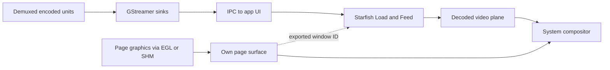

# Alternative webOS browsers and MultiView architecture

Research date: **2026-11-13**. Target: rooted LG OLED C1, webOS 6.5.3,
firmware 03.53.45. [Status](../../STATUS.md) · [Roadmap](../../ROADMAP.md) ·
[HDMI evidence map](c1-hdmi-interface-map.md) · [Our candidate](../../native/phase2-hdmi-window/README.md)

## 1. Executive summary

**Subsequent evidence, 2026-11-14:** the owner supplied Glasshouse, outside these
six repositories. Its pinned `startPreview()` uses HTML video with
`service/webos-external` / `ext://hdmi:<port>` and also has tuner source code.
This materially improves the smallest single-picture client option; the later standalone C1 trial verified one HDMI picture. Independent-port concurrency remains unknown. [Browser trials and route history](c1-hdmi-evidence-ledger.md#research-history). See the [pinned source
review and updated next-candidate implication](c1-hdmi-interface-map.md#glasshouse-preview-source-and-owner-observation).
The negative search conclusions below apply to the six original repositories.

**Useful presentation techniques were found, but no browser resolves simultaneous
HDMI acquisition or arbitrary installed-app embedding.** Keep the current
single-HDMI owned-window milestone, then prove independently live HDMI 1 + HDMI 2.
A browser port is not required by these findings.

- **Wren is the strongest reference for this C1 generation.** Its UI creates a
  Wayland surface group; cooperating WebKit processes attach their own page
  surfaces. It exports a video object on the page and passes its assigned ID to
  LG Starfish. This is relevant to HDMI plus **our own** rendered content, not
  evidence of a second HDMI receiver or another installed app's output. [W-owner], [W-render], [W-player]
- **Wren itself enforces single-player behavior.** A shared server owns one LG
  player, one NDL backend and one current stream; a new load unloads the previous
  stream. Its README attributes a limit to LG, but this implementation cannot
  isolate the physical decoder, compositor or media-service limit. Our existing
  same-app main/sub local-clip result also contradicts an unconditional inference
  that the C1 has only one usable decode/presentation combination. [W-server], [Local-media]
- **Brave separates ARM64 software browser rendering from ARM32 display/media.**
  Shared pixel buffers reach SDL textures; Starfish/ACB handles encoded video
  on the main sink. Useful separation and geometry examples, but its root-service
  launcher is not an appropriate substitute for our narrow client. [B-canvas], [B-host], [B-media]
- **Atlas and Enact embed web content through special platform hosts.** Their
  PageView/`<webview>` facilities are not demonstrated retail-C1 APIs or general
  native-app capture. Atlas's legacy installer performs system/service actions
  excluded by our safety rules. [A-view], [A-install], [E-view], [E-app]
- **Source availability and runtime variants matter.** The requested Chromium
  repository contains no native port implementation/patches at the inspected
  revision. Firefox exposes substantially more source and an older-libc build
  variant, but selects software rendering on webOS 6 and provides no demonstrated
  LG hardware-video bridge. [C-readme], [F-launch], [F-build]

**Recommendation:** keep single-HDMI acquisition before concurrency and retain
physical-picture/restoration acceptance gates. Optional graphics metadata and
cooperative-surface experiments remain proposals. This is a review of pinned
source as of the research date, not current upstream release advice. Later C1
readiness belongs in [Status](../../STATUS.md); do not repeat the old 0.1.3
admission sequence. Browser proposals did not change the product phases. No
browser integration, dependency installation, build, browser launch, TV connection,
permission deployment or system modification occurred in this research.

### Method and evidence levels

Inspected six recursive repository inventories, native/UI source, build and
packaging configuration, protocol definitions, seven relevant commit diffs and LG
documentation. Retained **271 selected text files** from the six pinned revisions,
plus nine relevant files from Wren's pinned native-app-kit submodule. Downloaded
source blobs were checked against their Git object IDs and recorded with SHA-256.
No downloaded script was executed. Release binaries were not installed or
ABI-certified. Captures are private under `build/browser-architecture-20261113/`.

**Verified/static** below means implementation is visible in code, not that our
TV executed it. **Reported/device** means an upstream author reports a result,
not our journal evidence. **Candidate** means an adaptation needs validation.
**Unknown/unsupported** means the capability is not established in scope;
**unsafe_to_test** identifies an action conflicting with our safety contract.

Negative searches cover selected downloaded source/build files, not omitted
upstream engines or unpublished binaries. They found no HDMI/UTP/tuner acquisition
or direct framebuffer/KMS plane-control implementation. This is a bounded search,
not proof that no undocumented interface exists.

## 2. Browser architecture comparison

Pins identify inspected source, not releases recommended for installation.

| Project | Pinned revision | Architecture visible in source | MultiView value and limit |
|---|---|---|---|
| Wren / WPE | `89fbd973ed25189afc19ed1f195a04673fb6b1e7` | SDL/native-app-kit UI, separate WPE engine/WebProcesses, custom webOS Wayland backend, GStreamer media IPC to UI Starfish/NDL. | Strongest C1 presentation reference; shared hardware player and active page layer, no physical-input acquisition. |
| Brave port | `0eac07a3fc537e9954707235ce6573ccde69f380` | ARM64 Brave/software Ozone canvas; ARM32 SDL display and Starfish/ACB helpers; bundled runtime/root supervisor. | Separates pixels, media and geometry; main sink only, substantial ABI/root complexity. |
| Native Chromium port | `c50c6db017b67686cfdfa6467ad5251f63814509` | Public tree has 10 blobs, mostly README, issue templates and feed assets. Native implementation/build patches absent. | Compatibility/feature statements are not independently source-verified port behavior. |
| Firefox port | `0e2693762504ddc9a482647d2b3b55baee7138c8` | ARM32 Gecko/GTK Wayland, app-local protocol adapter and software flattening for older compositors. | Compatibility warnings and ABI isolation ideas; no new hardware-input path. |
| Atlas | `e66556631c04468a0807533ebd23286b3fd42535` | Enyo UI; legacy TouchPad WPE/NPAPI BrowserAdapter or LuneOS Chromium `browser_shell` PageViews. | Web-view bounds/occlusion under specific hosts, not arbitrary installed apps. |
| Enact Browser | `8e8915fe631e30b707cb2e8a6b43ad2fac3545c8` | OSE JavaScript tab/browser library using host-provided guest `<webview>` in app-shell/Chrome-app environments. | Content partition/lifecycle ideas; does not implement a retail C1 graphics/media backend. |

Wren's native-app-kit pin is
`Native-Webos/webos-native-app-kit@312f3652dd945356e1676e14ee18c7d719eefb9a`.
Its inspected NDL/Starfish helpers are related media examples, not independent
HDMI services. [Kit]

## 3. Native graphics and compositor findings

### 3.1 Cooperative Wayland surfaces in Wren

`DirectOwner::open()` gets the existing SDL window's `wl_display`/`wl_surface`
through `SDL_GetWindowWMInfo`. `wpeb_owner_create()` binds
`wl_webos_surface_group_compositor`, roots a group in that surface and creates a
named layer. `wpeb_owner_set_z()` changes the layer's relative z-index. [W-direct], [W-owner]

The engine's `target_attach_locked()` looks up the group and attaches **its own**
surface. `target_add_role()` assigns `wl_shell` and `wl_webos_shell` roles.
The code uses a derived `<appId>.page` property: destroying surfaces carrying
the main app ID had reportedly minimized the whole app. That is a lifecycle
workaround, not authority to borrow an LG app/service identity. [W-render]

The surface-group XML defines named groups/layers, relative z-order, cooperative
attach, owner-destroyed notification and one surface per layer. Wren detaches the
previous page during handoff; its active page layer is not a simultaneous tab wall.
Separate cooperative layers are a candidate, with actual simultaneous visibility,
placement/scaling and teardown still needing proof. [Protocol], [W-render]

**Requirements:** appropriate globals, accepted shell roles, matching Wayland/EGL
ABI, app context and owner/member lifetime handling. Wren reports the default
path on C1 6.5.3/03.53.45; this task verified source only. [W-readme] These own-group calls
show no root/Luna policy mutation. They do not establish global LSM control or
ownership of physical overlay planes. **Confidence:** high in the static design;
candidate for our cooperating processes; unsupported for arbitrary-app capture.

### 3.2 EGL, shared pixels and video planes are distinct

The direct backend creates `wl_egl_window` objects and returns a Wayland native
display/window to libwpe. Its platform value zero allows vendor
`eglGetDisplay(wl_display)` rather than requiring `EGL_EXT_platform_wayland`.
A separate offscreen WebKit patch adds default-display/pbuffer alternatives to
Mesa surfaceless requirements. These are different contexts, not interchangeable
instructions. [W-render], [W-egl]

Wren's alternate `WPEBufferSHM` path transfers page pixels. Brave's
`WebOSCanvas::ResizeCanvas()` allocates/maps a shared regular file, wraps it in
Skia and passes the FD. The native host maps it and calls `SDL_UpdateTexture`.
These are software-pixel transport/composition paths, not zero-copy HDMI capture
or GPU rendering in Brave's Chromium process; its launcher disables browser GPU
use. Widgets/windows managed by that host are its own content. [W-shm], [B-canvas], [B-host], [B-launch]

None supplies decoded HDMI buffers, programs KMS overlay planes or turns another
client's surface into an arbitrary GPU texture. Browser GPU composition,
hardware video decoding and plane z-order must be recorded separately.

### 3.3 Exported video objects and hole punching

`wpeb_webos_video_open()` exports the shown page's own surface with
`wl_webos_foreign_export_element(...VIDEO_OBJECT)`, waits for its assigned ID and
passes it to media. `wpeb_webos_video_place()` applies source/destination regions
with `wl_webos_exported_set_exported_window`. [W-render]

This puts LG-decoded video under the intended page/hole, allowing page content
to overlay its own video. It is useful presentation-ownership evidence adjacent
to our export → window ID → UTP-open architecture. It does not establish that
UTP accepts the video-object export identically: our candidate deliberately uses
a transparent export/type 2 and `NormalWindow`. Do not substitute types or add
endpoints based solely on shared window-ID terminology. [Local-hdmi]

### 3.4 Firefox: advertised protocol is not visible output

`webos-xdg.c::flat_mode()` selects software flattening for particular older
compositors without `wl_subcompositor`. The launcher probes those conditions and
selects software WebRender. Its findings describe callback/release/GPU problems
on webOS 6.5.3/03.53.45 that differed from an emulator. Wren later reports working
grouped surfaces with specific roles/lifecycle handling. [F-launch], [F-adapter], [F-findings], [W-render]

These accounts establish neither universal C1 group success nor impossibility.
Different roles/setup are a plausible explanation, not a proved diagnosis.
Probe advertised interface → own-surface visibility → continuous frames → teardown.
Firefox's process-local interposition is not a proposal to hook MultiView or
modify the compositor. **Confidence:** static selection logic is clear; underlying
cross-client behavior remains candidate/device-dependent.

## 4. Video pipeline and decoder findings

### 4.1 Wren's encoded-media path

Its GStreamer `rialtomsevideosink`/`rialtomseaudiosink` integration accepts encoded
units; WebKit maintains the rectangle/transparent hole. IPC sends units to the
UI process, where `MediaServer` owns LG media calls. The source explains that
the app's Luna role belongs to that executable, so placing identical calls in a
WebProcess is not equivalent. [W-sink], [W-server-header]

`LgMediaPlayer::load()` builds `BUFFERSTREAM`/`RAW` options with actual app ID
and exported window ID, then calls `StarfishMediaAPIs::Load`. `Feed` receives
encoded units; Play/Pause/Seek/flush/EOS handle playback. Browser CMake links the
native kit and `libplayerAPIs`; NDL is the alternate path without suitable window
binding. This is encoded network/media playback, not HDMI ingestion. [W-player], [W-build], [Kit]

**Decoding and compositing are separate operations.** Starfish consumes encoded
media/resources; exported-surface binding and geometry place the result. This
path does not return decoded frames for arbitrary GLES composition. Neither
several decoder sessions nor several surfaces proves independently visible planes.

### 4.2 Interpreting the one-video limitation

`MediaServer` has one `LgMediaPlayer`, one NDL backend and one `owner_`.
Its `do_load` unloads existing LG/NDL playback and assigns the new owner;
feeding checks ownership. Thus the inspected Wren cannot show two independently
live hardware videos through that server, irrespective of an additional platform
limit. [W-server], [W-server-header]

The README's LG attribution does not isolate app policy, default sink contention,
window binding, compositor or silicon. Wren's inspected load path has no explicit
main/sub split. Our own C1 Phase 1 records same-app SMP main/sub overlap and
default-main contention in other variants. That cautions against treating Wren's
single-owner policy as a physical one-decoder law; it says nothing about a second
HDMI receiver. [W-player], [Local-media]

| Possible change | Evidence limit |
|---|---|
| More WPE WebProcesses | Still share the UI media server/app identity/current owner; not a bypass. |
| More player objects | Removes a software singleton only. Sink/resource ownership, two visible surfaces and safe cleanup still need proof. |
| Separate normally registered apps | May change policy/foreground allocation, not physical resources. Lifecycle may suspend one. No invented or borrowed IDs. |
| Independent media sinks | Relevant to our existing local-clip result; not implemented by Wren's shared server and not independent HDMI ingress. |
| Software video into our textures | Could avoid hardware-video allocation for that stream, at CPU/memory/bandwidth cost. HDMI coexistence remains untested. |

LG's public TV FAQ says simultaneous HTML media elements are not officially
supported. This is a public web-app support contract, not a private native
receiver-capacity test. Do not transfer signage/OSE concurrency to this consumer
C1. Underlying limits for new combinations remain **unknown**. [LG-faq]

### 4.3 Brave, Firefox and the unpublished Chromium implementation

Brave's `Player::Start()` creates ACB with `PLAYER_TYPE_MSE`, creates Starfish,
binds its media ID and loads encoded data. `Update()` attaches the **main** sink;
`Geometry()` scales viewport coordinates to 1920×1080 and calls
`AcbAPI_setDisplayWindow`. Decode, sink and geometry are distinct in code, but
no secondary HDMI/decoder path is demonstrated. Do not add ACB or private grants
to our current UTP trial on this basis. [B-media]

Firefox reports FFmpeg **software** video decoding, without a Starfish/NDL bridge.
GPU WebRender on another TV would not imply hardware video. Enabling a build
feature also does not establish a working VA-API driver. [F-readme], [F-launch]

The Chromium README advertises GPU/native video and describes an upstream build,
but its public tree lacks the port source/patches. That upstream reference is not
an audit of the unpublished modifications or concurrency behavior. [C-readme]

## 5. HDMI/tuner integration and multiple applications

**No physical-input acquisition implementation was identified in the available
browser source.** No inspected path opens UTP extinputs, selects HDMI 1/2,
allocates a tuner or demonstrates external-input PiP. Encoded network samples
and main ACB sink geometry are not HDMI capture. Our current UTP client remains
the more direct physical-input evidence. [Local-hdmi], [W-player], [B-media]

| Desired combination | Contribution here | Missing connection |
|---|---|---|
| HDMI + our graphics/web content | Own grouped surfaces and explicit video binding are promising presentation references. | UTP admission, live HDMI, group/hole interaction, lifetime/restoration. |
| HDMI + network video | Encoded-media helpers; software texture path is another candidate. | Receiver + decoder/sink/scaler coexistence and both pictures advancing. |
| HDMI 1 + HDMI 2 | No new acquisition/receiver-independence evidence. | Two physical-port paths and independent live presentation. |
| HDMI + tuner | No tuner/mixed receiver implementation found. | Tuner admission, ownership, binding and coexistence. |
| HDMI + arbitrary native app | No general adoption/capture path shown. | Producer cooperation/export or a separately evidenced private interface; root alone proves neither. |

Atlas `createPageView()` constructs a new `window.PageView` and adds it to its
own shell window. `syncBounds`/`pushBounds` map a placeholder rectangle to
`setBounds`; the source notes that existing page-content handles cannot simply
be adopted. Its overlay logic clips/hides the native page to reveal menus rather
than providing global z-order. [A-view], [A-overlay]

Enact creates a guest `document.createElement('webview')`, managing partitions,
lifecycle and messages. Its app metadata requires `native_appshell`. These are
host facilities, not standard HTML/Enact APIs guaranteed on retail C1, and guest
web content is not another installed webOS application. [E-view], [E-app]

## 6. LG C1 compatibility matrix

Saved C1 `libc.so.6` identifies glibc **2.28**; the existing runtime checks establish
ARM32 soft-float app ABI. An aarch64 kernel does not allow an ARM64 engine to
directly load ARM32 GPU/media libraries. This review checked source/build settings,
not release ELF closure. No browser was built, installed or TV-tested here.

| Project/path | C1 assessment | Evidence and requirements |
|---|---|---|
| Wren default softfp/direct path | **Strongest candidate; author reports matching C1/firmware.** | System GPU/media ABI plus bundled higher-level runtime. Source agrees with design; current release ABI, permissions and full dynamic closure remain unchecked by us. [W-readme], [W-render], [W-build], [W-launch] |
| Wren hard-float/private runtime | **Distinct variant, not equivalent GPU support.** | `EngineClient::start()` disables vendor-GPU mode for private-loader engines because softfp Mali libraries cannot load there. [W-launch] |
| Brave | **C1 integration unknown; root route outside current approach.** B9 success is an author report. | ARM64 engine/bundled runtime, ARM32 SDL/media, root HBC exec/supervisor with privilege drop. Software browser pixels add cost. Do not run deployment scripts. [B-config], [B-launch] |
| Chromium published build | **Declared unsuitable for current C1.** | README requires webOS 9+/glibc 2.35; source/patches for an older build are unpublished. Not our ELF measurement. [C-readme] |
| Firefox nc4/flat path | **Plausible software route; author reports matching webOS/firmware.** | `mozconfig-nc4` targets old glibc; software selected in flat mode. Older README/`mozconfig-arm32` describe a newer floor, so actual build variant/IPK ABI matters. [F-build], [F-findings] |
| Atlas | **Not a retail-C1 drop-in; legacy install unsafe_to_test here.** | TouchPad NPAPI/BrowserServer/Adreno or LuneOS PageView host. Installer stops jobs/processes and may restart Luna. [A-install], [A-readme] |
| Enact | **OSE-host dependent; C1 support unestablished.** | `native_appshell`, guest webview/injection APIs and OSE runtime assumptions. [E-view], [E-app] |

Portability requires protocol versions, accepted roles, actual frame progression,
driver/media ABI, CPU/libc variant and resource/lifecycle policy—not just a webOS
major version. Never replace system libraries or upgrade firmware to fit a port.

## 7. Reusable implementation techniques

These are adaptation candidates, not code adopted or work authorized now.

| Technique/source/API | How and hardware/firmware requirement | Value, limitation, confidence |
|---|---|---|
| Wren group owner/member: `DirectOwner`, `wpeb_owner_create`, `target_attach_locked`. [W-direct], [W-owner], [W-render] | Own root surface plus cooperating members; C1-compatible protocols, roles and EGL/Wayland ABI. | Good future own-process rendering architecture. High static confidence; simultaneous regions still candidate, no arbitrary-app capture. |
| Wren export/binding: `wpeb_webos_video_open/place`, `LgMediaPlayer::load`. [W-render], [W-player] | Assigned video-window ID connects media to its page; rectangle is in surface coordinates. | Strong presentation comparison. High static confidence, but UTP/export types differ. |
| Wren/Brave media IPC. [W-sink], [W-server], [B-media] | Encoded units/control reach the process with the appropriate LG ABI/app identity. | High static confidence as a network-source reference; adaptation untested. Must verify bounds/ownership; neither HDMI ingestion nor a concurrency bypass. |
| Brave sink/geometry: `Player::Update/Geometry`. [B-media] | Separates media Load, main-sink attachment and display placement; requires ACB/Starfish ABI. | Reinforces separate acceptance checks. Main sink is not a new secondary path. High static confidence. |
| Brave FD pixels: `WebOSCanvas` and SDL host. [B-canvas], [B-host] | Validated shared pixel buffer → texture. Requires compatible IPC/layout, not a shared vendor GPU ABI. | High static confidence; candidate cooperative software bridge. CPU cost/synchronization unmeasured on C1; not zero-copy video capture. |
| Atlas `syncBounds/pushBounds` and overlay clipping. [A-view], [A-overlay] | Layout rectangle controls a native PageView where that special host exists. | Reusable layout principle. High static confidence on host dependency; no C1 PageView or global stacking proof. |
| Firefox capability-based rendering selection. [F-launch], [F-adapter], [F-findings] | Probe real protocols and distinguish advertised support from successful frames. | High static confidence in selection logic; cross-model behavior unverified. Do not transplant its interposition shim or infer visibility from a global name. |

## 8. Technical risks and blockers

1. **Independent receivers remain the central uncertainty.** None of these
   browsers identifies a second HDMI-port path. A layer, MSE player or exported
   video object is not receiver evidence.
2. **Lifecycle/ownership:** Wren's page-role/crash handling shows why group attach
   acceptance is insufficient. A child must not minimize/strand the parent. Other
   installed apps have their own foreground/resource policy.
3. **Cleanup:** Wren's `LgMediaPlayer::unload()` moves Unload/destruction to a
   detached thread; it does not prove bounded hardware release. Its overallocated
   media-object storage/retention is an ABI workaround, not a verified object
   layout or a cleanup pattern to import. Keep our unknown-release reports and
   owner contingency. [W-player]
4. **ABI and load:** bundled/system glibc/C++, softfp/hard-float/ARM64 and vendor
   drivers cannot be mixed by path. Multiple engines, CPU video and texture copies
   can exhaust resources. No PS5 latency/resolution/HDR/VRR guarantee follows.
5. **Unsafe operational patterns:** do not copy Brave's generic root execution
   route or Atlas's service-modifying installer. Firefox's app-local protocol
   interposition is not a proposed MultiView hook. No service restart, kernel
   interface or compositor patch is justified.
6. **DRM/HDCP:** browser encrypted-stream playback is separate from protected
   HDMI. No bypass, CDM adaptation or secure-buffer investigation is proposed.
7. **Licensing:** Wren/native-app-kit declare GPL-3.0; Brave port code declares
   MIT with upstream obligations; Atlas declares Apache-2.0 in its README. No
   top-level Firefox adapter license was found in its inventory; do not assume
   Gecko's license covers that code. Enact uses
   `LicenseRef-EnactBrowser-Evaluation`, not a general permissive license. Any
   future code copying needs file/component checks; none occurred here. [W-license], [B-license], [A-readme], [E-license]

## 9. Ranked experiments and proposed roadmap amendments

These proposals were recorded on 2026-11-13, before the later 0.1.4 installation/activation results; they are not a current task queue. No browser experiment was implemented/run. Device proposals require separate owner scope,
bounds, sanitized capture and restoration where active.

| Rank | Proposal | Feasibility / value for MultiView | Acceptance/boundary |
|---|---|---|---|
| 1 | Preserve acquisition/admission evidence gates before the single-HDMI trial. | High / central immediate value. | The dated 0.1.3 admission proposal is superseded by later 0.1.4 verification/activation; follow Status rather than repeating it. Browser research bypasses no gate. |
| 2 | Optional read-only Wayland/EGL capability snapshot, saved evidence first. | High / useful cross-model metadata. | Own non-rendering connection, globals/versions/library/extension facts; bounded sanitized flags. No surfaces, exports, groups, existing-app inspection or service mutation. Advertising is not rendering proof. |
| 3 | Continue the planned single-HDMI owned-window trial after its gates. | Conditional / central product proof. | Real motion in fixed rectangle, bounded client and observed restoration. No browser integration or export-type/private-grant substitution. |
| 4 | HDMI 1 + HDMI 2, only after evidence of independent allocation and two moving devices. | Unknown / highest ultimate value. | Existing simultaneous-motion/release/restoration gates. No speculative dual open based on browser layers. |
| 5 | Later, two cooperating own synthetic rendering clients/layers. | Medium / useful for HDMI plus owned content. | Fixed regions, both advancing, role/z-order/lifetime/teardown correct. No other installed app or hardware video. |
| 6 | After single-HDMI proof, HDMI plus cooperative graphics; low-cost software network video later if useful. | Medium / mixed-source evidence. | Both advance without takeover/suspension/resource switching; measure CPU/memory. Owned web content is not arbitrary app embedding. |
| 7 | Further network hardware pipelines/separate app identities. | Lower priority / secondary scope. | Reuse our main/sub evidence first. Multiple Load success alone is insufficient; no fabricated IDs or generic root helper. |

### Proposed wording only — do not modify the roadmap yet

- **Phase 2 evidence rule:** record receiver acquisition, decoder/sink allocation,
  exported-surface binding and UI/GPU composition separately. Optionally add a
  passive graphics-protocol/ABI record with visibility unknown until tested.
  Wren/Firefox differences support this distinction.
- **Mixed-source gate:** distinguish cooperating application-owned producers from
  arbitrary installed applications. A bounded own-surface group experiment may
  follow single-HDMI proof; no global capture/geometry claim. Supported by
  Wren/Atlas's ownership boundaries.
- **Compatibility matrix:** add protocol/role behavior, actual frame progression,
  ABI/runtime variant, sink and lifecycle/cleanup, not just webOS version or
  successful browser startup. Brave/Firefox/Chromium requirements justify this.

The current roadmap already separates acquisition/presentation and requires
independently live physical inputs. These proposals clarify recording and later
mixed-source acceptance; they do not justify a browser-integration phase, new
permissions, a changed proof of concept or delaying first-picture work for a port.

## 10. Source references, commits and reproducibility

References below are pinned files. Functions/classes in sections 3–7 identify
the relevant implementations. Maintainer device reports are not our TV tests.

Reviewed relevant history includes Wren's [video-window integration][WH1],
[page-role/crash lifetime fixes][WH2] and [media load timing fix][WH3]; Brave's
[native media release][BH1]; Firefox's [webOS-6 flattening fix][FH1]; Atlas's
[PageView error handling][AH1]; and Enact's [app-shell dependency change][EH1].
Commit messages distinguish built/installed/tested states and do not constitute
a blanket validation of all current features. Atlas/Enact test hosts are not C1.

The inspected diffs corroborate the architectural boundaries: Wren adds the
exported video window/Starfish bridge, changes child-page role identity and fixes
a deferred-Load timeout; Brave adds encoded-media playback; Firefox avoids
recopying a released software buffer; Atlas combines visibility conditions;
Enact adds an app-shell-dependent PWA facility. None adds physical-input
acquisition or a demonstrated two-HDMI allocation route. [WH1], [WH2], [WH3], [BH1], [FH1], [AH1], [EH1]

Local captures include each inventory, selected `source/` files with blob/hash
verification, `source-inventory.json`, the pinned kit inventory,
`focused-history.json`, `commit-details-index.json`, the seven saved commit diffs
and `bounded-search.json` under
`build/browser-architecture-20261113/`. The unavailable GitHub connector was
replaced with public GitHub API/raw-content reads. These are research captures,
not dependencies. Roadmap/current plan, native code, policy, tests and IPKs remain
unchanged. Validation is source-pin/document integrity and links; no builds or
device experiments were appropriate to this research-only task.

[W-direct]: https://github.com/sostk/webos-wpe-browser/blob/89fbd973ed25189afc19ed1f195a04673fb6b1e7/browser/direct_owner.cpp#L22-L89
[W-owner]: https://github.com/sostk/webos-wpe-browser/blob/89fbd973ed25189afc19ed1f195a04673fb6b1e7/engine/webos-backend/owner.c#L55-L119
[W-render]: https://github.com/sostk/webos-wpe-browser/blob/89fbd973ed25189afc19ed1f195a04673fb6b1e7/engine/webos-backend/wpebackend-webos.c#L628-L1115
[W-egl]: https://github.com/sostk/webos-wpe-browser/blob/89fbd973ed25189afc19ed1f195a04673fb6b1e7/buildroot-external/patches/wpewebkit/0002-use-the-default-EGL-display-without-Mesa-surfaceless.patch
[W-shm]: https://github.com/sostk/webos-wpe-browser/blob/89fbd973ed25189afc19ed1f195a04673fb6b1e7/engine/src/main.cpp#L224-L255
[W-sink]: https://github.com/sostk/webos-wpe-browser/blob/89fbd973ed25189afc19ed1f195a04673fb6b1e7/engine/gst/wpebmediasink.c
[W-server]: https://github.com/sostk/webos-wpe-browser/blob/89fbd973ed25189afc19ed1f195a04673fb6b1e7/browser/media_server.cpp#L242-L289
[W-server-header]: https://github.com/sostk/webos-wpe-browser/blob/89fbd973ed25189afc19ed1f195a04673fb6b1e7/browser/media_server.hpp#L38-L53
[W-player]: https://github.com/sostk/webos-wpe-browser/blob/89fbd973ed25189afc19ed1f195a04673fb6b1e7/browser/lg_media_player.cpp#L80-L304
[W-build]: https://github.com/sostk/webos-wpe-browser/blob/89fbd973ed25189afc19ed1f195a04673fb6b1e7/browser/CMakeLists.txt#L31-L39
[W-launch]: https://github.com/sostk/webos-wpe-browser/blob/89fbd973ed25189afc19ed1f195a04673fb6b1e7/browser/engine_client.cpp#L55-L102
[W-readme]: https://github.com/sostk/webos-wpe-browser/blob/89fbd973ed25189afc19ed1f195a04673fb6b1e7/README.md
[W-license]: https://github.com/sostk/webos-wpe-browser/blob/89fbd973ed25189afc19ed1f195a04673fb6b1e7/LICENSE
[Kit]: https://github.com/Native-Webos/webos-native-app-kit/tree/312f3652dd945356e1676e14ee18c7d719eefb9a/media
[WH1]: https://github.com/sostk/webos-wpe-browser/commit/e4d831297d6887d4955dc5285bef41d71b2b64a7
[WH2]: https://github.com/sostk/webos-wpe-browser/commit/ad8df32f745166892d66739467198d042760a254
[WH3]: https://github.com/sostk/webos-wpe-browser/commit/e5804c714277ed5843be503bd2c2445ddac63b96
[B-media]: https://github.com/pecrow/WebOS-Brave-Browser-Port/blob/0eac07a3fc537e9954707235ce6573ccde69f380/src/media/native_media.cc#L61-L342
[B-canvas]: https://github.com/pecrow/WebOS-Brave-Browser-Port/blob/0eac07a3fc537e9954707235ce6573ccde69f380/src/ozone/webos_canvas.cc#L43-L83
[B-host]: https://github.com/pecrow/WebOS-Brave-Browser-Port/blob/0eac07a3fc537e9954707235ce6573ccde69f380/src/display/host.c#L280-L320
[B-launch]: https://github.com/pecrow/WebOS-Brave-Browser-Port/blob/0eac07a3fc537e9954707235ce6573ccde69f380/app/launch.sh
[B-config]: https://github.com/pecrow/WebOS-Brave-Browser-Port/blob/0eac07a3fc537e9954707235ce6573ccde69f380/build-config.json
[B-license]: https://github.com/pecrow/WebOS-Brave-Browser-Port/blob/0eac07a3fc537e9954707235ce6573ccde69f380/LICENSE
[BH1]: https://github.com/pecrow/WebOS-Brave-Browser-Port/commit/19c5435831558e8c6190ab18906ac0a0cb660af2
[C-readme]: https://github.com/sarahahzub/WebOS-Chromium/blob/c50c6db017b67686cfdfa6467ad5251f63814509/README.md
[F-launch]: https://github.com/gprot42/webos-firefox/blob/0e2693762504ddc9a482647d2b3b55baee7138c8/src/geckotv.c#L129-L225
[F-adapter]: https://github.com/gprot42/webos-firefox/blob/0e2693762504ddc9a482647d2b3b55baee7138c8/src/webos-xdg.c#L1270-L1293
[F-findings]: https://github.com/gprot42/webos-firefox/blob/0e2693762504ddc9a482647d2b3b55baee7138c8/findings.md#L710-L1020
[F-readme]: https://github.com/gprot42/webos-firefox/blob/0e2693762504ddc9a482647d2b3b55baee7138c8/README.md
[F-build]: https://github.com/gprot42/webos-firefox/blob/0e2693762504ddc9a482647d2b3b55baee7138c8/build/mozconfig-nc4
[FH1]: https://github.com/gprot42/webos-firefox/commit/0e2693762504ddc9a482647d2b3b55baee7138c8
[Protocol]: https://github.com/gprot42/webos-firefox/blob/0e2693762504ddc9a482647d2b3b55baee7138c8/src/webos-surface-group.xml#L20-L226
[A-view]: https://github.com/webOS-ports/org.webosports.app.atlas/blob/e66556631c04468a0807533ebd23286b3fd42535/source/engine/ChromiumWebView.js#L83-L181
[A-overlay]: https://github.com/webOS-ports/org.webosports.app.atlas/blob/e66556631c04468a0807533ebd23286b3fd42535/source/engine/ChromiumOverlay.js
[A-install]: https://github.com/webOS-ports/org.webosports.app.atlas/blob/e66556631c04468a0807533ebd23286b3fd42535/packaging/ipk-postinst.sh
[A-readme]: https://github.com/webOS-ports/org.webosports.app.atlas/blob/e66556631c04468a0807533ebd23286b3fd42535/README.md
[AH1]: https://github.com/webOS-ports/org.webosports.app.atlas/commit/e148635e654162efe6a597aa3414a78b7fbd4a69
[E-view]: https://github.com/webosose/com.webos.app.enactbrowser/blob/8e8915fe631e30b707cb2e8a6b43ad2fac3545c8/src/WebView.js#L203-L341
[E-app]: https://github.com/webosose/com.webos.app.enactbrowser/blob/8e8915fe631e30b707cb2e8a6b43ad2fac3545c8/samples/enact-based/webos-meta/appinfo.json
[E-license]: https://github.com/webosose/com.webos.app.enactbrowser/blob/8e8915fe631e30b707cb2e8a6b43ad2fac3545c8/LICENSE
[EH1]: https://github.com/webosose/com.webos.app.enactbrowser/commit/d524ed54405d1d2d8f714c000768877c5f0b62b0
[LG-faq]: https://webostv.developer.lge.com/faq?ccm_paging_p=2&faqCategoryID=Technical+FAQ
[Local-media]: c1-smp-ndl-resource-path.md
[Local-hdmi]: c1-hdmi-interface-map.md
